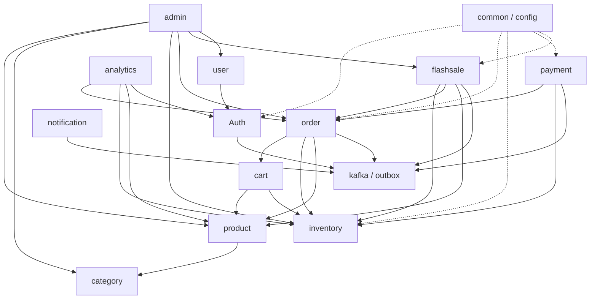
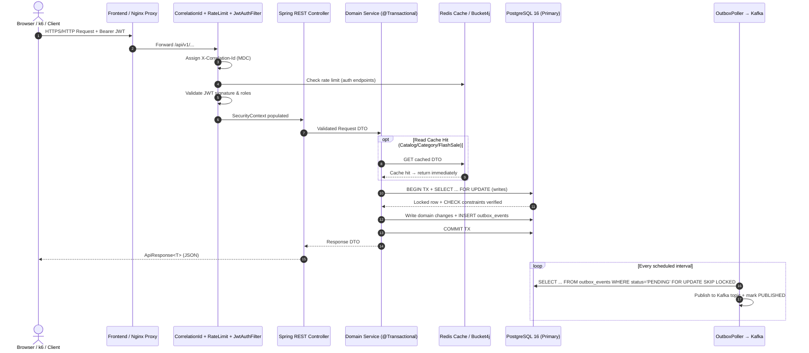

# FlashCart Architecture

FlashCart is engineered as a **Modular Monolith** in Spring Boot 3.4 (Java 21) backed by PostgreSQL 16, Redis 7, and Apache Kafka 3.7, paired with a React 19 + TypeScript single-page application.

---

## 1. Why Modular Monolith (Not Microservices)

Choosing a modular monolith over distributed microservices was a deliberate architectural decision driven by correctness, operational simplicity, and concurrency guarantees:

1. **ACID Transactions Across Core Commerce Flows**: Creating an order, reserving inventory (`SELECT FOR UPDATE`), inserting an `inventory_reservations` row, and writing an `outbox_events` record happen inside a **single local PostgreSQL ACID transaction**. With microservices, this would require distributed sagas or 2PC, introducing partial-failure states and compensating-transaction complexity.
2. **Zero Network Hop Overhead on Hot Paths**: Under a flash sale spike (e.g., 10,000 concurrent purchase requests), avoiding synchronous RPC hops between `order`, `inventory`, and `flashsale` eliminates serialization overhead, network timeouts, and cascading failures.
3. **Single Operational Footprint**: One Spring Boot JAR, one Flyway migration pipeline, and one unified CI/CD build reduce infrastructure cost and cognitive load while preserving strict package-level boundaries.
4. **Clear Extraction Seam**: Because modules communicate through service interfaces and domain events (via the Transactional Outbox), high-throughput or independently scaling domains (such as `notification` or `inventory`) can be extracted cleanly later.

### Trade-offs Made

| Dimension | Benefit of Modular Monolith | Trade-off Accepted |
|---|---|---|
| **Consistency** | Single ACID transaction spans inventory, order, payment, and outbox | Modules share a single PostgreSQL database instance |
| **Deployment** | Single build, atomic release, zero version skew | Scaling requires scaling the entire backend process horizontally |
| **Latency** | In-process Java method calls (microseconds) | A heavy CPU/memory spike in analytics affects the same JVM unless isolated |
| **Development** | Fast local Docker Compose setup and End-to-End testing | Requires strict package discipline to avoid coupling |

---

## 2. Module Boundaries and Responsibilities

All backend business logic lives under `com.flashcart.<module>`:

| Module | Package | Core Responsibilities | Primary Tables Owned |
|---|---|---|---|
| **auth** | `com.flashcart.auth` | Registration, login, JWT issuance, refresh token rotation & reuse detection, password reset, rate limiting | `users`, `refresh_tokens`, `password_reset_tokens` |
| **user** | `com.flashcart.user` | Customer profile retrieval/updates, shipping address book CRUD | `addresses` (plus profile fields on `users`) |
| **category** | `com.flashcart.category` | Hierarchical product categories, slug lookup, admin CRUD | `categories` |
| **product** | `com.flashcart.product` | Product catalog CRUD, trigram/text search, filtering, sorting, local image upload/serving | `products`, `product_images` |
| **inventory** | `com.flashcart.inventory` | Authoritative stock tracking, pessimistic `SELECT FOR UPDATE` reservation, expiry scheduler | `inventory`, `inventory_reservations` |
| **cart** | `com.flashcart.cart` | Persistent shopping carts, quantity validation, server-side subtotal calculation | `carts`, `cart_items` |
| **order** | `com.flashcart.order` | Checkout orchestration, immutable `OrderItem` snapshots, order state machine, cancellation | `orders`, `order_items` |
| **payment** | `com.flashcart.payment` | Idempotent payment simulator (success/failure/timeout/refund), late-callback protection | `payments` |
| **flashsale** | `com.flashcart.flashsale` | Flash sale scheduling, atomic stock decrement (`sold_count`), Redis admission control | `flash_sales`, `flash_sale_items` |
| **notification** | `com.flashcart.notification` | Event-driven notification tracking (`PENDING → QUEUED → DELIVERED/FAILED`), mock email logger | `notifications` |
| **admin** | `com.flashcart.admin` | Admin operations facade (customers, order status management, catalog & inventory overrides) | Cross-module read/admin delegation |
| **analytics** | `com.flashcart.analytics` | Revenue time series, top products, order breakdown, low-stock alerts from PostgreSQL | Read-only aggregations across `orders`, `order_items`, `inventory` |
| **kafka** | `com.flashcart.kafka` | Transactional outbox writer/poller (`FOR UPDATE SKIP LOCKED`), Kafka producers/consumers, DLT | `outbox_events`, `processed_events` |
| **common** | `com.flashcart.common` | `ApiResponse`, `PageResponse`, domain exceptions, `GlobalExceptionHandler`, enums, correlation MDC | None |

---

## 3. Layer Structure

Every business module follows a strict four-layer flow:

```
HTTP Request
   │
   ▼
Controller (REST endpoints, @Valid request DTOs, auth principal extraction — NO business logic)
   │
   ▼
Service (Explicit @Transactional boundaries, business invariants, outbox event emission)
   │
   ▼
Repository (Spring Data JPA interfaces, custom @Query / native SQL locking queries)
   │
   ▼
Entity / DTO (JPA entities never leave the service/controller boundary; mapped to DTOs)
```

### Dependency Rules
- **No circular module dependencies**: Dependencies form a directed acyclic graph (DAG).
- **Entities never leak across HTTP boundaries**: Controllers accept Request DTOs and return `ApiResponse<ResponseDTO>` or `ApiResponse<PageResponse<ResponseDTO>>`.
- **Server-side authority**: Frontend-submitted prices, totals, and stock quantities are never trusted; services recompute prices from `products` or `flash_sale_items` inside the transaction.

---

## 4. Module Dependency Diagram



---

## 5. Request Lifecycle Diagram



---

## 6. Infrastructure Architecture

### Database Architecture (PostgreSQL 16)
- **Single database, module-owned tables**: All 19 tables reside in the `public` schema of PostgreSQL 16, managed strictly via Flyway (`V1__initial_schema.sql`, `V2__indexes.sql`, `V3__seed_data.sql`). Hibernate `ddl-auto` is set to `validate` in dev/prod so schema drift fails fast at startup.
- **Database-enforced invariants**:
  - `inventory`: `CONSTRAINT reserved_lte_total CHECK (reserved_stock <= total_stock)` and non-negative checks.
  - `flash_sale_items`: `CONSTRAINT sold_lte_sale_stock CHECK (sold_count <= sale_stock)`.
  - `flash_sales`: `CONSTRAINT end_after_start CHECK (end_time > start_time)`.

### Redis Architecture (Redis 7)
Redis serves two non-authoritative acceleration and protection roles:
1. **Look-aside Caching**: Caches product listings, individual product details, category trees, and short-TTL active flash-sale metadata via Spring's `RedisCacheManager`. Cache eviction happens on admin mutations.
2. **Admission Control & Rate Limiting**: Optional fast pre-check on flash sales (rejecting obvious post-sellout traffic before hitting PostgreSQL) and rate limiting state.
3. **Graceful Degradation**: If Redis is unreachable, FlashCart logs a warning and falls back directly to PostgreSQL without crashing startup or dropping orders.

### Kafka Architecture (Apache Kafka 3.7 + Transactional Outbox)
- **No dual writes**: Domain services never call `KafkaTemplate.send()` directly inside a business transaction. Instead, they write JSON payloads to `outbox_events` in the same DB transaction.
- **Outbox Poller**: A `@Scheduled` publisher polls `PENDING` rows using `FOR UPDATE SKIP LOCKED`, publishes to Kafka topics, and updates `status = 'PUBLISHED'`.
- **Idempotent Consumers**: Downstream consumers record `event_id` in `processed_events` inside the consumer transaction before applying side effects (such as sending/recording notifications or releasing inventory). Failures route through configured retries to Dead Letter Topics (`*.DLT`).

---

## 7. Security Architecture

- **Stateless API Access**: Short-lived HMAC-SHA256 JWT access tokens (`15 min` default) passed via `Authorization: Bearer <token>` and held in React memory (never `localStorage`).
- **Rotated Refresh Tokens**: Long-lived opaque/UUID refresh tokens (`7 days` default) stored in `HttpOnly`, `SameSite=Strict` cookies and persisted in `refresh_tokens`. Rotating a token marks the old token `used = true`; presenting an already-used refresh token triggers **reuse detection** and revokes all active refresh tokens for that user.
- **RBAC + Ownership (IDOR Prevention)**: Spring Security enforces `ROLE_CUSTOMER` vs `ROLE_ADMIN` on routes, while service methods verify `resource.userId.equals(authenticatedUser.getId())` on user-scoped resources (`orders`, `addresses`, `payments`).

---

## 8. Future Extraction Points

If traffic outgrows a single JVM deployment, the cleanest extraction sequence is:
1. **Notification Worker** (`notification/`): Already decoupled via Kafka (`order.events`, `payment.events`, `auth.events`); can be moved to an independent consumer service with zero DB coupling.
2. **Analytics Read Service** (`analytics/`): Can point to a PostgreSQL read replica or materialized warehouse fed by Kafka events.
3. **Flash-Sale & Inventory Service** (`flashsale/` + `inventory/`): Can move to a dedicated high-throughput service + dedicated PostgreSQL cluster, exposing atomic reservation RPCs while `order/` retains checkout orchestration.
