# FlashCart Database Design

FlashCart uses **PostgreSQL 16** as the single system of record across all modular monolith domains. Schema evolution is strictly controlled by **Flyway** (`classpath:db/migration`), with Hibernate configured to `ddl-auto: validate` and `open-in-view: false` (`jdbc.time_zone: UTC`).

---

## 1. Entity-Relationship Diagram

```mermaid
erDiagram
    users ||--o{ refresh_tokens : "has"
    users ||--o{ password_reset_tokens : "requests"
    users ||--o{ addresses : "saves"
    users ||--o| carts : "owns"
    users ||--o{ orders : "places"
    users ||--o{ inventory_reservations : "reserves"
    users ||--o{ flash_sales : "creates"
    users ||--o{ notifications : "receives"

    categories ||--o{ categories : "parent_id"
    categories ||--o{ products : "categorizes"

    products ||--o{ product_images : "has"
    products ||--|| inventory : "tracked_by"
    products ||--o{ cart_items : "in_cart"
    products ||--o{ flash_sale_items : "discounted_in"

    carts ||--o{ cart_items : "contains"
    orders ||--o{ order_items : "snapshots"
    orders ||--o{ payments : "paid_by"

    inventory ||--o{ inventory_reservations : "allocated_to"
    flash_sales ||--o{ flash_sale_items : "includes"
    flash_sale_items ||--o{ inventory_reservations : "linked_to"

    users {
        uuid id PK
        varchar email UK
        varchar password_hash
        varchar first_name
        varchar last_name
        varchar phone
        varchar role
        boolean enabled
        timestamptz created_at
        timestamptz updated_at
    }

    refresh_tokens {
        uuid id PK
        varchar token UK
        uuid user_id FK
        timestamptz expires_at
        boolean used
        timestamptz revoked_at
        timestamptz created_at
    }

    password_reset_tokens {
        uuid id PK
        varchar token UK
        uuid user_id FK
        timestamptz expires_at
        boolean used
        timestamptz created_at
    }

    categories {
        bigserial id PK
        varchar name UK
        text description
        varchar slug UK
        text image_url
        boolean active
        integer sort_order
        bigint parent_id FK
        timestamptz created_at
        timestamptz updated_at
    }

    products {
        uuid id PK
        varchar name
        text description
        varchar sku UK
        numeric price
        numeric compare_at_price
        bigint category_id FK
        boolean active
        timestamptz created_at
        timestamptz updated_at
    }

    product_images {
        uuid id PK
        uuid product_id FK
        text image_url
        varchar alt_text
        integer sort_order
        boolean is_primary
        timestamptz created_at
    }

    inventory {
        uuid id PK
        uuid product_id UK,FK
        integer total_stock
        integer reserved_stock
        bigint version
        timestamptz updated_at
    }

    inventory_reservations {
        uuid id PK
        uuid inventory_id FK
        uuid user_id FK
        uuid order_id
        uuid flash_sale_item_id FK
        varchar idempotency_key UK
        integer quantity
        varchar status
        timestamptz expires_at
        timestamptz confirmed_at
        timestamptz released_at
        timestamptz created_at
        timestamptz updated_at
    }

    addresses {
        uuid id PK
        uuid user_id FK
        varchar full_name
        varchar phone
        varchar address_line1
        varchar address_line2
        varchar city
        varchar state
        varchar postal_code
        varchar country
        boolean is_default
        timestamptz created_at
        timestamptz updated_at
    }

    carts {
        uuid id PK
        uuid user_id UK,FK
        timestamptz created_at
        timestamptz updated_at
    }

    cart_items {
        uuid id PK
        uuid cart_id FK
        uuid product_id FK
        integer quantity
        timestamptz created_at
        timestamptz updated_at
    }

    orders {
        uuid id PK
        varchar order_number UK
        uuid user_id FK
        varchar status
        varchar shipping_full_name
        varchar shipping_address_line1
        varchar shipping_address_line2
        varchar shipping_city
        varchar shipping_state
        varchar shipping_postal_code
        varchar shipping_country
        varchar shipping_phone
        numeric subtotal
        numeric discount_amount
        numeric total_amount
        text notes
        timestamptz created_at
        timestamptz updated_at
    }

    order_items {
        uuid id PK
        uuid order_id FK
        uuid product_id
        varchar product_name
        varchar product_sku
        numeric unit_price
        integer quantity
        numeric total_price
        uuid flash_sale_id
        timestamptz created_at
    }

    payments {
        uuid id PK
        uuid order_id FK
        varchar idempotency_key UK
        numeric amount
        varchar status
        varchar provider
        varchar transaction_id
        text failure_reason
        timestamptz processed_at
        timestamptz created_at
        timestamptz updated_at
    }

    flash_sales {
        uuid id PK
        varchar name
        text description
        timestamptz start_time
        timestamptz end_time
        boolean active
        uuid created_by FK
        timestamptz created_at
        timestamptz updated_at
    }

    flash_sale_items {
        uuid id PK
        uuid flash_sale_id FK
        uuid product_id FK
        numeric sale_price
        integer sale_stock
        integer sold_count
        timestamptz created_at
        timestamptz updated_at
    }

    notifications {
        uuid id PK
        uuid user_id FK
        varchar type
        varchar subject
        text body
        varchar status
        timestamptz sent_at
        integer retry_count
        timestamptz created_at
        timestamptz updated_at
    }

    outbox_events {
        uuid id PK
        varchar aggregate_type
        varchar aggregate_id
        varchar event_type
        text payload
        varchar status
        timestamptz published_at
        integer retry_count
        timestamptz created_at
    }

    processed_events {
        varchar event_id PK
        timestamptz processed_at
    }
```

---

## 2. Table & Column Catalog (19 Tables)

### Auth & User Domain

#### `users`
| Column | Type | Constraints | Purpose |
|---|---|---|---|
| `id` | `UUID` | `PRIMARY KEY DEFAULT gen_random_uuid()` | Unique user identifier |
| `email` | `VARCHAR(255)` | `UNIQUE NOT NULL` | Login identifier |
| `password_hash` | `VARCHAR(255)` | `NOT NULL` | BCrypt hash (cost factor 10) |
| `first_name` | `VARCHAR(100)` | `NOT NULL` | User first name |
| `last_name` | `VARCHAR(100)` | Nullable | User last name |
| `phone` | `VARCHAR(20)` | Nullable | Contact number |
| `role` | `VARCHAR(20)` | `NOT NULL DEFAULT 'CUSTOMER'` | `CUSTOMER` or `ADMIN` |
| `enabled` | `BOOLEAN` | `NOT NULL DEFAULT true` | Account active/locked status |
| `created_at` / `updated_at` | `TIMESTAMPTZ` | `NOT NULL DEFAULT NOW()` | Audit timestamps |

#### `refresh_tokens` & `password_reset_tokens`
- **`refresh_tokens`**: `id`, `token (UNIQUE)`, `user_id (FK → users ON DELETE CASCADE)`, `expires_at`, `used (BOOLEAN DEFAULT false)`, `revoked_at`, `created_at`. Tracks token rotation and reuse detection.
- **`password_reset_tokens`**: `id`, `token (UNIQUE)`, `user_id (FK → users ON DELETE CASCADE)`, `expires_at`, `used (BOOLEAN DEFAULT false)`, `created_at`. Single-use time-bounded password reset tokens.

#### `addresses`
Stores customer shipping addresses (`user_id FK → users ON DELETE CASCADE`, `full_name`, `phone`, `address_line1`, `address_line2`, `city`, `state`, `postal_code`, `country DEFAULT 'India'`, `is_default`).

### Catalog Domain

#### `categories`
Hierarchical category tree (`BIGSERIAL` PK for compact FK joins and predictable sort ordering): `id`, `name (UNIQUE)`, `description`, `slug (UNIQUE)`, `image_url`, `active`, `sort_order`, `parent_id (self-referential FK ON DELETE SET NULL)`.

#### `products` & `product_images`
- **`products`**: `id (UUID PK)`, `name`, `description (TEXT)`, `sku (UNIQUE)`, `price NUMERIC(10,2) CHECK (price >= 0)`, `compare_at_price NUMERIC(10,2) CHECK (compare_at_price >= 0)`, `category_id (FK → categories ON DELETE SET NULL)`, `active`.
- **`product_images`**: `id`, `product_id (FK → products ON DELETE CASCADE)`, `image_url`, `alt_text`, `sort_order`, `is_primary`, `created_at`.

### Inventory & Flash-Sale Domain

#### `inventory`
| Column | Type | Constraints | Purpose |
|---|---|---|---|
| `id` | `UUID` | `PRIMARY KEY` | Inventory row ID |
| `product_id` | `UUID` | `UNIQUE NOT NULL FK → products(id) ON DELETE CASCADE` | 1:1 stock row per product |
| `total_stock` | `INTEGER` | `NOT NULL DEFAULT 0 CHECK (total_stock >= 0)` | Physical units owned |
| `reserved_stock` | `INTEGER` | `NOT NULL DEFAULT 0 CHECK (reserved_stock >= 0)` | Units held by active reservations |
| `version` | `BIGINT` | `NOT NULL DEFAULT 0` | JPA `@Version` field |
| `updated_at` | `TIMESTAMPTZ` | `NOT NULL DEFAULT NOW()` | Last stock change |
| **Table Constraint** | `CHECK` | `CONSTRAINT reserved_lte_total CHECK (reserved_stock <= total_stock)` | Guarantees `available_stock = total_stock - reserved_stock >= 0` |

#### `inventory_reservations`
Tracks reservation lifecycle (`CREATED → CONFIRMED | RELEASED | EXPIRED`):
- `id`, `inventory_id (FK → inventory)`, `user_id (FK → users)`, `order_id (UUID)`, `flash_sale_item_id (FK → flash_sale_items ON DELETE SET NULL)`, `idempotency_key (UNIQUE NOT NULL)`, `quantity CHECK (quantity > 0)`, `status`, `expires_at`, `confirmed_at`, `released_at`, `created_at`, `updated_at`.

#### `flash_sales` & `flash_sale_items`
- **`flash_sales`**: `id`, `name`, `description`, `start_time`, `end_time`, `active`, `created_by (FK → users)`, with `CONSTRAINT end_after_start CHECK (end_time > start_time)`.
- **`flash_sale_items`**: `id`, `flash_sale_id (FK ON DELETE CASCADE)`, `product_id (FK)`, `sale_price NUMERIC(10,2) CHECK (sale_price >= 0)`, `sale_stock CHECK (sale_stock >= 0)`, `sold_count DEFAULT 0 CHECK (sold_count >= 0)`, `UNIQUE (flash_sale_id, product_id)`, and **`CONSTRAINT sold_lte_sale_stock CHECK (sold_count <= sale_stock)`**.

### Commerce, Payments & Messaging Domain

#### `carts` & `cart_items`
- **`carts`**: `id`, `user_id (UNIQUE NOT NULL FK → users ON DELETE CASCADE)`.
- **`cart_items`**: `id`, `cart_id (FK → carts ON DELETE CASCADE)`, `product_id (FK → products ON DELETE CASCADE)`, `quantity CHECK (quantity > 0)`, `UNIQUE (cart_id, product_id)`.

#### `orders` & `order_items`
> Note: Table is named `orders` (plural) because `order` is a reserved SQL keyword.
- **`orders`**: `id`, `order_number (UNIQUE)`, `user_id (FK → users)`, `status` (`PENDING`, `PAYMENT_PENDING`, `CONFIRMED`, `PROCESSING`, `SHIPPED`, `DELIVERED`, `CANCELLED`, `PAYMENT_FAILED`, `REFUNDED`), immutable shipping address snapshot columns (`shipping_full_name`, `shipping_address_line1`, etc.), `subtotal`, `discount_amount`, `total_amount`, `notes`.
- **`order_items`**: Immutable purchase-time snapshots (`product_id`, `product_name`, `product_sku`, `unit_price`, `quantity`, `total_price`, `flash_sale_id`). No FK cascade from `products` mutation—changing product prices or names later never mutates historical orders.

#### `payments`
`id`, `order_id (FK → orders)`, `idempotency_key (UNIQUE NOT NULL)`, `amount NUMERIC(10,2)`, `status` (`PENDING`, `SUCCEEDED`, `FAILED`, `REFUNDED`, `CANCELLED`), `provider` (`SIMULATOR`), `transaction_id`, `failure_reason`, `processed_at`.

#### `notifications`, `outbox_events`, `processed_events`
- **`notifications`**: Tracks `PENDING`, `QUEUED`, `DELIVERED`, `FAILED` email/system notifications (`user_id`, `type`, `subject`, `body`, `sent_at`, `retry_count`).
- **`outbox_events`**: Transactional outbox rows (`aggregate_type`, `aggregate_id`, `event_type`, `payload TEXT`, `status`, `published_at`, `retry_count`, `created_at`).
- **`processed_events`**: Consumer idempotency deduplication table (`event_id VARCHAR(255) PRIMARY KEY`, `processed_at`).

---

## 3. Index Strategy (`V2__indexes.sql`)

| Index | Table & Columns | Type | Rationale |
|---|---|---|---|
| `idx_products_name_trgm` | `products (name gin_trgm_ops)` | `GIN` | Fast case-insensitive `ILIKE '%term%'` and fuzzy search without sequential scan |
| `idx_products_category_id`, `idx_products_active`, `idx_products_price`, `idx_products_created_at` | `products` | `B-Tree` | Filtered, sorted, paginated storefront queries |
| `idx_inv_res_expires_at_status` | `inventory_reservations (expires_at) WHERE status = 'CREATED'` | Partial `B-Tree` | Expiry scheduler scans only un-expired/active reservations, keeping index tiny forever |
| `idx_inv_res_inventory_id_status`, `idx_inv_res_idempotency_key`, `idx_inv_res_order_id`, `idx_inv_res_user_id` | `inventory_reservations` | `B-Tree` | Fast idempotency lookup and order-level confirm/release locking |
| `idx_outbox_status_created` | `outbox_events (status, created_at) WHERE status = 'PENDING'` | Partial `B-Tree` | Outbox poller ignores millions of historical `PUBLISHED` rows |
| `idx_orders_user_id`, `idx_orders_status`, `idx_orders_created_at`, `idx_orders_order_number` | `orders` | `B-Tree` | Customer order history & admin dashboards |
| `idx_flash_sales_active`, `idx_flash_sales_start_end`, `idx_flash_sale_items_*` | `flash_sales`, `flash_sale_items` | `B-Tree` | Active flash sale window lookup |
| `idx_payments_order_id`, `idx_payments_idempotency_key`, `idx_payments_status` | `payments` | `B-Tree` | Payment callback deduplication and status lookup |

---

## 4. Data Representation & Migration Strategy

### Monetary Values: `NUMERIC(10, 2)` + Java `BigDecimal`
Binary floating-point types (`FLOAT`, `DOUBLE PRECISION`) cannot represent base-10 fractions like `0.10` or `19.99` exactly, causing penny drift in order totals and financial reconciliation. PostgreSQL `NUMERIC(10, 2)` paired with Java `BigDecimal` guarantees exact decimal arithmetic up to `99,999,999.99`.

### Primary Keys: UUID (`gen_random_uuid()` / `GenerationType.UUID`)
- Prevents ID enumeration / predictable scraping (supports IDOR defense in depth alongside server-side ownership checks).
- Allows client-generated or deterministic idempotency keys and future sharding/service extraction without central sequence coordination.
- Exception: `categories` uses `BIGSERIAL` (`Long`) because categories are small, public, non-sensitive taxonomy trees where compact B-Tree join keys are advantageous.

### Timestamps: `TIMESTAMPTZ` + UTC
All timestamps use PostgreSQL `TIMESTAMPTZ` (`Instant` in Java, `hibernate.jdbc.time_zone: UTC`). PostgreSQL normalizes instants to UTC internally, preventing DST/timezone bugs on reservation expirations and flash-sale start/end comparisons.

### Flyway Migration Strategy
1. `V1__initial_schema.sql`: Extensions (`pgcrypto`, `pg_trgm`), all 19 tables, and all CHECK/UNIQUE/FK constraints.
2. `V2__indexes.sql`: All B-Tree, GIN trigram, and partial indexes.
3. `V3__seed_data.sql`: Development seed users, categories, catalog products, inventory rows, and active flash-sale fixtures (including a 100-stock item for concurrency testing).
4. **Immutable history**: Applied Flyway migrations are never edited after execution; schema changes require a new `V{N}__...sql` script.
