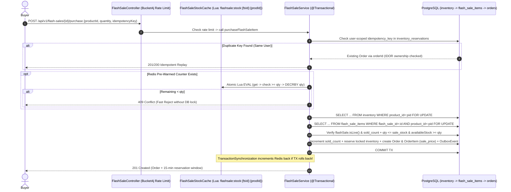

# FlashCart Flash-Sale Engine Design

Flash sales compress hours of e-commerce traffic into seconds, turning normal catalog browsing into a **thundering herd** targeting a single SKU.

---

## 1. The 100-Units / 10,000-Requests Problem

When 100 units of a heavily discounted item drop at sale start, 10,000+ client requests can hit `POST /api/v1/flash-sales/{id}/purchase` within seconds.

### Why This Is Hard
1. **Thundering Herd**: Thousands of threads hit the database concurrently for the same product row.
2. **Oversell Risk**: Any race between checking `sold_count < sale_stock` and incrementing `sold_count` causes negative remaining stock or more than 100 winners.
3. **Duplicate Retries**: Impatient users (or mobile clients on flaky networks) double-tap or retry the purchase button, potentially consuming 2 slots for 1 purchase unless idempotent.
4. **Database Pool Exhaustion**: Even after all 100 units sell out in the first 200ms, the remaining 9,900 requests can saturate HikariCP (`maximum-pool-size: 30`) unless fast-failed cleanly.

---

## 2. Flash-Sale Data Model (Separate Sale Quota vs. Regular Inventory)

FlashCart separates **flash sale quota** (`flash_sale_items`) from **warehouse inventory** (`inventory`):

- **`flash_sales`**: Defines the time window (`start_time`, `end_time`, `active`) with `CONSTRAINT end_after_start CHECK (end_time > start_time)`.
- **`flash_sale_items`**:
  - `sale_price NUMERIC(10, 2)`: Promotional price valid only while `flashSale.isLive()` is true.
  - `sale_stock INTEGER`: Promotional cap allocated to the flash sale (validated on creation/update against warehouse `availableStock`).
  - `sold_count INTEGER`: Units claimed so far.
  - `CONSTRAINT sold_lte_sale_stock CHECK (sold_count <= sale_stock)`: PostgreSQL hard-blocks selling unit #101.
- **`inventory_reservations.flash_sale_item_id`**: Links the timed reservation back to `flash_sale_items`, so if a flash-sale buyer fails to pay before `expires_at` (or cancels/refunds), `InventoryService` calls `flashSaleItemRepository.decrementSoldCount(...)` AND restores `inventory.reserved_stock` together!

---

## 3. Concurrency Control Architecture

### Pessimistic Locking + DB CHECK Constraint (`FlashSaleService`)
1. `InventoryService.lockInventoryByProductId(productId)` acquires a PostgreSQL `PESSIMISTIC_WRITE` (`SELECT ... FOR UPDATE`) lock on `inventory` **first**, followed by `FlashSaleItemRepository.findByFlashSaleIdAndProductIdForUpdate(flashSaleId, productId)` on `flash_sale_items`—enforcing a strict global lock hierarchy (`Inventory -> FlashSaleItem`) identical to `InventoryService` release/expiry paths to eliminate cross-transaction deadlocks.
2. `FlashSaleService` validates `flashSale.isLive()` (`active && !now.isBefore(startTime) && !now.isAfter(endTime)`), `(soldCount + quantity <= saleStock)`, and warehouse `availableStock >= quantity` while holding both row locks.
3. It persists the incremented `soldCount`, reserves against the already-locked `inventory` (`reserveLockedInventory`), creates the `Order` and `OrderItem` using the server-side `salePrice`, and emits `"OrderCreated"` to `outbox_events`.
4. Even if any SQL bypass occurred, PostgreSQL's `CONSTRAINT sold_lte_sale_stock CHECK (sold_count <= sale_stock)` and `CONSTRAINT reserved_lte_total CHECK (reserved_stock <= total_stock)` prevent overselling at the storage engine level.

---

## 4. Idempotency Key Design

- **User-Scoped Key (`IdempotencyKeyUtils`)**: `FlashSaleController` reads `Idempotency-Key` header or `request.getIdempotencyKey()` (or generates a random UUID), and scopes it per user and flash sale (`IdempotencyKeyUtils.scopeForUser(user.getId(), "fs:" + flashSaleId, rawKey)`) so one buyer's key can never collide with or leak another buyer's order (IDOR defense).
- **Enforced in DB**: `inventory_reservations.idempotency_key` has a `UNIQUE NOT NULL` constraint.
- **Behavior on Retry**: Before decrementing Redis or acquiring locks, `FlashSaleService` checks `reservationRepository.findByIdempotencyKey(idempotencyKey)` and verifies `user.getId()` ownership. If found with an `orderId`, it immediately returns the existing `OrderDto` without decrementing stock a second time.

---

## 5. Redis as Admission Control (`FlashSaleStockCache`)

When a flash sale item is created or updated, `FlashSaleService` schedules an `afterCommit` warm-up in `FlashSaleStockCache` (`flashsale:stock:{flashSaleId}:{productId}`) with remaining stock and TTL (`endTime - now + 5m`):
- **Atomic Lua Pre-Filter**: On purchase, `FlashSaleStockCache.tryDecrementIfAvailable(...)` runs a single atomic Redis Lua script that checks `tonumber(val) >= qty` and calls `DECRBY` in one round trip (avoiding check-then-decrement races). If insufficient, it returns `SOLD_OUT` (`409 Conflict`) without acquiring PostgreSQL locks.
- **Transaction-Synchronized Rollback & Sync**: `TransactionSynchronization.afterCompletion` restores the Redis counter (`incrementIfPresent` Lua script) if the DB transaction rolls back, and `InventoryService` syncs Redis counters `afterCommit` whenever reservations are cancelled, refunded, or expired.
- **Graceful Degradation**: If the key is absent or Redis is unreachable, `FlashSaleStockCache` returns `BYPASS` and `FlashSaleService` falls back cleanly to PostgreSQL `SELECT FOR UPDATE`.

---

## 6. Remaining Stock Display & Multi-Instance Safety

- **Remaining Stock Display**: `FlashSaleItem.getRemainingStock()` computes `Math.max(0, saleStock - soldCount)`. Public endpoints (`GET /api/v1/flash-sales` and `GET /api/v1/flash-sales/live`) are cached in Redis (`flashSales`, 30s TTL) and evicted on admin mutations or purchases.
- **Multi-Instance Safety**: Every critical check—sale time window (`TIMESTAMPTZ` UTC), `findByFlashSaleIdAndProductIdForUpdate`, `inventory` `SELECT FOR UPDATE`, `idempotency_key` uniqueness, and `sold_lte_sale_stock`—executes inside PostgreSQL.

---

## 7. Concurrency Test Verification

Tested via:
1. **Integration Concurrency Test** (JUnit 5 + Testcontainers PostgreSQL): Fires concurrent threads against a 100-unit `FlashSaleItem`.
2. **k6 Rush Test** (`tests/load/flash-sale-concurrency.js`): Targets `POST /api/v1/flash-sales/${FLASH_SALE_ID}/purchase` with up to 10,000 attempts and asserts `successful_reservations <= 100` with `0` oversells.

> **Verification Status (Verified 2026-11-11)**:
> - **Testcontainers (`FlashSaleConcurrencyIntegrationTest`)**: **`3/3 PASS` in `34.90 s`** (`100` threads / `10,000` attempts vs `100` stock = **`100` confirmed**, **`9,900` rejected**, **`0` oversells**; plus Redis-bypassed direct PostgreSQL lock verification `25/250`).
> - **Live k6 Rush (`100 → 10,000 req/s`, `ELEC-001` `100` stock, direct Docker bridge)**: `1,228` completed HTTP requests yielding **`100` confirmed** reservations (`expected_response:true p50 = 11.10 s, p95 = 14.14 s`), **`54` sold-out `409 Conflict`**, **`1,072` rate-limited `429`** (single `customer1` Bucket4j limit), **`0` unexpected 5xx**, and **`0` oversells** verified in PostgreSQL (`flash_sale_items.sold_count = 100/100`, `inventory.reserved_stock = 100`, `flash_sale_orders = 100`).
> - See [docs/PERFORMANCE.md](./PERFORMANCE.md) and [.project/TEST_RESULTS.md](../.project/TEST_RESULTS.md) for full details.
