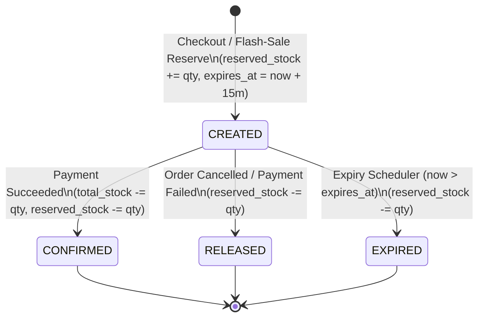

# FlashCart Inventory Concurrency Engineering

Preventing overselling under extreme concurrency is the core systems engineering problem solved by FlashCart.

---

## 1. The Core Problem & Why Naive Implementations Fail

Suppose a product has **1 unit of available stock**, and **2 concurrent checkout threads (T1 and T2)** attempt to buy 1 unit at the exact same millisecond.

### Failure Mode 1: Read-Then-Write Race (TOCTOU — Time-of-Check to Time-of-Use)
```
T1: SELECT total_stock, reserved_stock FROM inventory WHERE product_id = X  --> available = 1
T2: SELECT total_stock, reserved_stock FROM inventory WHERE product_id = X  --> available = 1
T1: Checks (1 >= 1) -> TRUE! UPDATE inventory SET reserved_stock = 0 + 1 = 1
T2: Checks (1 >= 1) -> TRUE! UPDATE inventory SET reserved_stock = 0 + 1 = 1 (or 2 if relative)
Result: Two orders confirmed for 1 physical unit -> OVERSELLING!
```

### Failure Mode 2: Application-Level Synchronization (`synchronized` / `ReentrantLock`)
- Fails completely when running **more than 1 backend instance** (horizontally scaled containers/pods).
- Breaks across JVM restarts.
- Cannot protect against direct concurrent transactions from background jobs (like reservation expiry).

### Failure Mode 3: Optimistic Locking Alone (`@Version`) Under Flash Sales
- Under 10,000 concurrent requests for 100 items, **99% of threads fail with `ObjectOptimisticLockingFailureException`**, triggering massive retry storms, wasted CPU, and unpredictable tail latency.

---

## 2. FlashCart's Solution: PostgreSQL Pessimistic Locking + CHECK Constraint

FlashCart places **PostgreSQL 16** as the single, authoritative concurrency coordinator using two layers of defense:

### Defense Layer 1: Pessimistic Row-Level Lock (`SELECT ... FOR UPDATE`)
In `InventoryRepository`:
```java
@Lock(LockModeType.PESSIMISTIC_WRITE)
@Query("SELECT i FROM Inventory i WHERE i.product.id = :productId")
Optional<Inventory> findByProductIdForUpdate(@Param("productId") UUID productId);
```
Hibernate translates this into:
```sql
SELECT i.* FROM inventory i WHERE i.product_id = $1 FOR UPDATE;
```
PostgreSQL acquires an exclusive row-level write lock (`RowExclusive` / `FOR UPDATE`) on that specific product's inventory row. All other transactions attempting to reserve or release the same product wait in PostgreSQL's lock queue until the active transaction commits or rolls back—reading the **latest committed** `total_stock` and `reserved_stock` with zero stale-read TOCTOU anomalies.

### Defense Layer 2: Database-Level `CHECK` Constraint (Safety Net)
Even if an application bug, raw SQL script, or future developer bypasses service checks, `V1__initial_schema.sql` makes negative available stock **physically impossible** in PostgreSQL:
```sql
CREATE TABLE inventory (
    id UUID PRIMARY KEY DEFAULT gen_random_uuid(),
    product_id UUID UNIQUE NOT NULL REFERENCES products(id) ON DELETE CASCADE,
    total_stock INTEGER NOT NULL DEFAULT 0 CHECK (total_stock >= 0),
    reserved_stock INTEGER NOT NULL DEFAULT 0 CHECK (reserved_stock >= 0),
    version BIGINT NOT NULL DEFAULT 0,
    updated_at TIMESTAMPTZ NOT NULL DEFAULT NOW(),
    CONSTRAINT reserved_lte_total CHECK (reserved_stock <= total_stock)
);
```
- **Invariant**: `Available Stock = total_stock - reserved_stock`
- Because `reserved_stock <= total_stock` is enforced at commit/statement time by PostgreSQL, any update violating the invariant raises a `23514` (`check_violation`) error and rolls back the entire transaction.

---

## 3. Reservation Lifecycle State Machine



### Idempotency Keys
Every reservation carries a `UNIQUE NOT NULL` `idempotency_key` (`inventory_reservations.idempotency_key`).
- Before acquiring inventory locks or after unique-key check, `InventoryService` checks `findByIdempotencyKey(key)`.
- If the client retries a timed-out HTTP request with the same `idempotencyKey`, the service returns the existing reservation instead of reserving stock a second time.
- Under simultaneous duplicate retries, the `UNIQUE` index on `idempotency_key` guarantees at most one insert succeeds.

### Deadlock Prevention (Canonical Global Lock Ordering)
When a multi-item cart checks out (`N` products) or flash-sale purchases/expiries update both `inventory` and `flash_sale_items`, acquiring `SELECT ... FOR UPDATE` locks in arbitrary order can cause deadlocks (`Thread A` locks Product 1 then wants Product 2; `Thread B` locks Product 2 then wants Product 1, or checkout locks `FlashSaleItem -> Inventory` while expiry locks `Inventory -> FlashSaleItem`).
- **Mitigation**: All write paths (`OrderService`, `FlashSaleService`, `InventoryService`, `PaymentService`) follow a strict global lock hierarchy:
  `Payment → Order → InventoryReservation → Inventory (ascending UUID) → FlashSaleItem (ascending UUID)`.

---

## 4. Multi-Instance Safe Expiry Mechanism

If a user abandons checkout or never completes payment within `flashcart.reservation.ttl-minutes` (default `15` minutes), the held stock must be returned automatically—**exactly once**, even if 5 backend replicas run the `@Scheduled` expiry job simultaneously.

### How `InventoryReservationRepository` Guarantees Single Release
1. **Partial Index Lookup**:
   ```sql
   SELECT id FROM inventory_reservations
   WHERE status = 'CREATED' AND expires_at < NOW();
   ```
   Backed by partial index `idx_inv_res_expires_at_status ON inventory_reservations(expires_at) WHERE status = 'CREATED'`.
2. **Atomic Compare-And-Swap Claim** (`claimExpiredReservation`):
   ```sql
   UPDATE inventory_reservations
   SET status = 'EXPIRED', released_at = :now, updated_at = :now
   WHERE id = :id AND status = 'CREATED';
   ```
   - PostgreSQL evaluates the `WHERE status = 'CREATED'` condition atomically under a row write lock.
   - If Replica A and Replica B both pick up reservation `R`, **only one replica receives `updatedRows == 1`**. The other receives `updatedRows == 0` and skips releasing stock!
   - When `FOR UPDATE SKIP LOCKED` is used for batch polling (as in `OutboxEvent` publishing or batched reservation sweeping), worker replicas also avoid blocking on rows another instance currently holds.
3. **Stock Restoration**: Only the winning instance (where `updatedRows == 1`) locks the parent `inventory` row (`findByIdForUpdate`) and decrements `reserved_stock` (and `flash_sale_items.sold_count` if `flash_sale_item_id` is present).
4. **Atomic Guard on Normal Confirm/Release (`transitionFromCreated`)**:
   ```sql
   UPDATE inventory_reservations
   SET status = :newStatus, confirmed_at = :confirmedAt, released_at = :releasedAt, updated_at = :now
   WHERE id = :id AND status = 'CREATED';
   ```
   This guarantees a reservation that just transitioned to `EXPIRED` cannot concurrently transition to `CONFIRMED` on a late payment callback.

---

## 5. Multi-Instance Safety & Crash Recovery

- **Multi-Instance Safety**: Because locks (`FOR UPDATE`), uniqueness (`idempotency_key`), state transitions (`WHERE status = 'CREATED'`), and invariants (`reserved_lte_total`) all execute inside PostgreSQL transactions, adding 2, 5, or 20 stateless Spring Boot instances requires zero coordination changes.
- **Application Restart Mid-Reservation**:
  - If the JVM crashes *before* PostgreSQL `COMMIT`, PostgreSQL automatically aborts the open transaction and releases row locks immediately when the TCP connection closes—zero leaked locks or phantom stock deductions.
  - If the JVM crashes *after* PostgreSQL `COMMIT`, the `CREATED` reservation is durably persisted with `expires_at`; when any backend instance boots or continues running, the expiry scheduler cleans it up automatically if unpaid.

---

## 6. Alternative Approaches Considered

| Approach | How It Works | Why Accepted / Rejected for FlashCart |
|---|---|---|
| **Pessimistic `SELECT ... FOR UPDATE` + `CHECK` constraint** *(Chosen)* | Database serializes row mutations; `CHECK` prevents invariant breach | Zero overselling, zero retry storms, multi-instance safe, simple mental model |
| **Optimistic Locking (`@Version`)** | Read without lock, `UPDATE ... WHERE version = v`, retry on conflict | High abort/retry rate under 10,000-request flash-sale contention |
| **Redis `DECRBY` Only** | Decrement counter in Redis memory | Non-authoritative; Redis failover or RDB/AOF sync gap risks overselling or split-brain vs. PostgreSQL orders |
| **Redis Admission Control + PostgreSQL Lock** *(Flash Sale Enhancement)* | Redis fast-rejects obvious excess once sold out; PostgreSQL remains final authority | Best of both worlds: protects DB pool while preserving ACID guarantees |
| **Single-Writer Queue / Kafka Partition** | Serialize purchase requests into a partitioned queue | Adds async UX complexity (polling order status) whereas synchronous checkout gives instant confirmation |

---

## 7. Concurrency Test Design & Verification Status

The mandatory concurrency verification suite tests:
- **100 units** of initial stock (both regular inventory and flash sale stock).
- **High-concurrency burst** (up to **10,000 concurrent purchase attempts** via Java `ExecutorService` + `CountDownLatch` in Testcontainers and k6 `tests/load/flash-sale-concurrency.js`).
- **Assertions**:
  1. Confirmed / successful reservations `<= 100` (specifically `== 100` when >= 100 unique valid requests arrive).
  2. `total_stock >= reserved_stock >= 0` in PostgreSQL after the storm completes.
  3. Sum of `inventory_reservations` (`status IN ('CREATED', 'CONFIRMED')`) equals exact units deducted (`== 100`).
  4. Duplicate requests sharing the same `idempotency_key` never consume double stock.

> **Verification Status (Verified 2026-11-11)**:
> - **Testcontainers (`FlashSaleConcurrencyIntegrationTest`)**: **`3/3 PASS` in `34.90 s`** — `100` threads / `10,000` concurrent attempts vs `100` stock yielded **`100` confirmed**, **`9,900` rejected**, **`0` oversells** (plus Redis-bypassed direct PostgreSQL lock check `25/250`).
> - **Live k6 Flash-Sale Rush (`tests/load/flash-sale-concurrency.js`)**: Confirmed **`0` oversells** directly in PostgreSQL (`flash_sale_items.sold_count = 100/100`, `inventory.reserved_stock = 100`, `flash_sale_orders = 100`).
> - See [docs/PERFORMANCE.md](./PERFORMANCE.md) and [.project/TEST_RESULTS.md](../.project/TEST_RESULTS.md) for full benchmark metrics and test logs.
