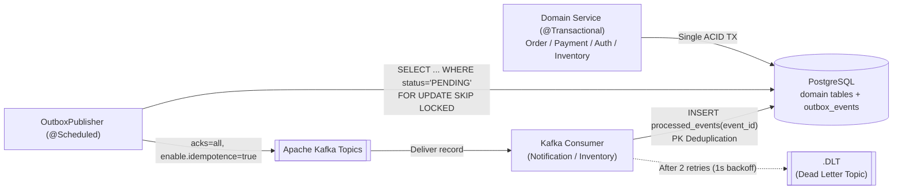

# FlashCart Kafka Event Flow & Transactional Outbox

FlashCart uses **Apache Kafka 3.7** (`spring-kafka`) combined with the **Transactional Outbox Pattern** to emit reliable domain events without distributed 2-phase commits or dual-write bugs.

---

## 1. Why the Transactional Outbox Pattern?

Without an outbox, calling `repository.save(order)` (PostgreSQL) and `kafkaTemplate.send(...)` (Kafka) in the same service method suffers from the **Dual-Write Problem**:
- If PostgreSQL commits and Kafka is temporarily unreachable (or the JVM crashes right before `send()`), the event is **lost forever**—no confirmation notification is sent.
- If `kafkaTemplate.send()` runs before PostgreSQL commits and the transaction rolls back (e.g., `CHECK` constraint violation), downstream consumers receive a **phantom event** for an order that does not exist!

**FlashCart's Solution**: Domain services write an `OutboxEvent` row into PostgreSQL **inside the same `@Transactional` boundary** as the domain state change. Either both commit atomically or both roll back.

---

## 2. Outbox Architecture & Flow

---

## 3. Outbox & Consumer Idempotency Schemas

### `outbox_events` (`V1__initial_schema.sql`)
| Column | Type | Purpose |
|---|---|---|
| `id` | `UUID PK` | Unique event ID (used as Kafka message key/event ID for consumer deduplication) |
| `aggregate_type` | `VARCHAR(100)` | Domain entity type (`Order`, `Payment`, `Inventory`, `User`) |
| `aggregate_id` | `VARCHAR(255)` | Entity UUID (used as Kafka partition key to preserve per-aggregate ordering) |
| `event_type` | `VARCHAR(100)` | Event name (`OrderCreated`, `PaymentSucceeded`, `PaymentFailed`, `InventoryReleased`, etc.) |
| `payload` | `TEXT` | JSON event body |
| `status` | `VARCHAR(20)` | `PENDING`, `PUBLISHED`, or `FAILED` |
| `published_at` | `TIMESTAMPTZ` | Timestamp when Kafka broker acknowledged receipt |
| `retry_count` | `INTEGER` | Failed publish attempts counter |
| `created_at` | `TIMESTAMPTZ` | Creation timestamp (indexed via partial index `WHERE status = 'PENDING'`) |

### `processed_events` (`V1__initial_schema.sql`)
| Column | Type | Purpose |
|---|---|---|
| `event_id` | `VARCHAR(255) PRIMARY KEY` | Tracks already-processed Kafka event IDs |
| `processed_at` | `TIMESTAMPTZ NOT NULL` | Timestamp of consumption |

---

## 4. Topic Configuration (`KafkaConfig.java`)

| Topic | Partitions | Replicas (Dev) | Dead-Letter Topic |
|---|---|---|---|
| `flashcart.order.created` | 3 | 1 | `flashcart.order.created.DLT` |
| `flashcart.payment.succeeded` | 3 | 1 | `flashcart.payment.succeeded.DLT` |
| `flashcart.payment.failed` | 3 | 1 | `flashcart.payment.failed.DLT` |
| `flashcart.inventory.released` | 3 | 1 | *(configured via recoverer if enabled)* |
| `flashcart.notification.requested` | 3 | 1 | *(configured via recoverer if enabled)* |

---

## 5. Event Catalog

| Event Type | Topic | Producer Module | Payload Summary | Consumers |
|---|---|---|---|---|
| `OrderCreated` | `flashcart.order.created` | `order` / `flashsale` | `eventId`, `orderId`, `orderNumber`, `userId`, `totalAmount`, `items`, `createdAt` | `notification` / analytics audit |
| `PaymentSucceeded` | `flashcart.payment.succeeded` | `payment` | `eventId`, `paymentId`, `orderId`, `userId`, `amount`, `transactionId`, `processedAt` | `notification` (order confirmation email) |
| `PaymentFailed` | `flashcart.payment.failed` | `payment` | `eventId`, `paymentId`, `orderId`, `userId`, `reason`, `processedAt` | `notification` (payment failure alert) |
| `InventoryReleased` | `flashcart.inventory.released` | `inventory` / `payment` | `eventId`, `reservationId`, `inventoryId`, `productId`, `orderId`, `quantity`, `reason` | Audit / downstream inventory metrics |
| `NotificationRequested` | `flashcart.notification.requested` | `auth` / `order` | `eventId`, `userId`, `type`, `subject`, `body` | `notification` (registration / password reset) |

---

## 6. Outbox Publisher & Multi-Instance Safety

- **Mandatory Transaction Guard (`OutboxService`)**: `OutboxService.recordEvent(...)` is annotated with `@Transactional(propagation = Propagation.MANDATORY)`. Attempting to emit an outbox event outside an active database transaction fails immediately—guaranteeing no domain service can accidentally publish an event without sharing the ACID commit/rollback boundary.
- **Standard `DomainEvent` Envelope**: Every outbox payload serializes a `DomainEvent` JSON object (`eventId`, `eventType`, `aggregateType`, `aggregateId`, `occurredAt`, `data`).
- **Polling Publisher (`OutboxPublisher`)**: Runs via `@Scheduled(fixedDelay = 2000)`, claiming up to 100 `PENDING` events ordered by `created_at ASC` via `OutboxEventRepository.findPendingBatchForPublish(...)` (`SELECT * FROM outbox_events WHERE status = :status ORDER BY created_at ASC LIMIT 100 FOR UPDATE SKIP LOCKED`), backed by partial index `idx_outbox_status_created`.
- **Synchronous Broker Acknowledgment**: Calls `kafkaTemplate.send(topic, aggregateId, payload).get(5, TimeUnit.SECONDS)` so `status` only flips to `PUBLISHED` after the Kafka broker acknowledges receipt. Failed attempts increment `retryCount` up to `MAX_RETRIES = 5` before marking `OutboxStatus.FAILED`.
- **Optional Zero-Kafka Mode (`KAFKA_ENABLED=false`)**: `OutboxPublisher`, `KafkaEventConsumer`, and `KafkaConfig` are gated by `@ConditionalOnProperty(name = "flashcart.kafka.enabled", havingValue = "true", matchIfMissing = true)`, whereas `OutboxService` stays active—allowing zero-cost deployments without Kafka to still persist domain events cleanly in PostgreSQL.
- **Multi-Instance Safety**: Because `findPendingBatchForPublish` acquires `FOR UPDATE SKIP LOCKED` inside `@Transactional`, multiple `OutboxPublisher` replicas claim disjoint `PENDING` batches concurrently without blocking or double-publishing.
- **Kafka Producer Config (`application.yml`)**:
  - `acks: all` (all in-sync replicas acknowledge write)
  - `retries: 3`
  - `enable.idempotence: true` (prevents broker-level duplicate appends during producer network retries)

---

## 7. Consumer Idempotency, Retries & Dead-Letter Topics

- **Offset Management (`application.yml`)**:
  - `group-id: flashcart-group`
  - `enable-auto-commit: false`
  - `listener.ack-mode: record` (commits offset only after listener method succeeds)
  - `auto-offset-reset: earliest`
- **Idempotent Consumption**:
  1. Consumer parses `eventId` from the message payload/headers.
  2. Inside `@Transactional`, checks/inserts `eventId` into `processed_events` (`PRIMARY KEY`).
  3. If `eventId` already exists (redelivery after broker rebalance or crash before offset commit), the consumer logs and skips duplicate side effects cleanly.
- **Retries & DLT (`KafkaConfig.kafkaErrorHandler`)**:
  - Uses `DefaultErrorHandler` with `FixedBackOff(1000L, 2L)` (2 retry attempts, 1 second apart).
  - After retries are exhausted, `DeadLetterPublishingRecoverer` routes the poison message to `<topic>.DLT` so bad payloads never stall healthy partition consumers.

---

## 8. Delivery Guarantees (Why At-Least-Once, NOT Exactly-Once)

FlashCart provides **at-least-once delivery** + **idempotent consumers (effectively-once processing)**:
- **Why we do NOT claim "exactly-once delivery"**: In distributed messaging across independent systems (PostgreSQL + Kafka + Email/Notifications), true end-to-end exactly-once *delivery* across network partitions is impossible (e.g., Kafka sends a message, the broker commits, and the outbox publisher crashes before marking `status = 'PUBLISHED'`, causing a re-publish on restart).
- **How correctness is achieved anyway**: Because consumers deduplicate via `processed_events` inside PostgreSQL, redelivered messages produce zero duplicate side effects.
