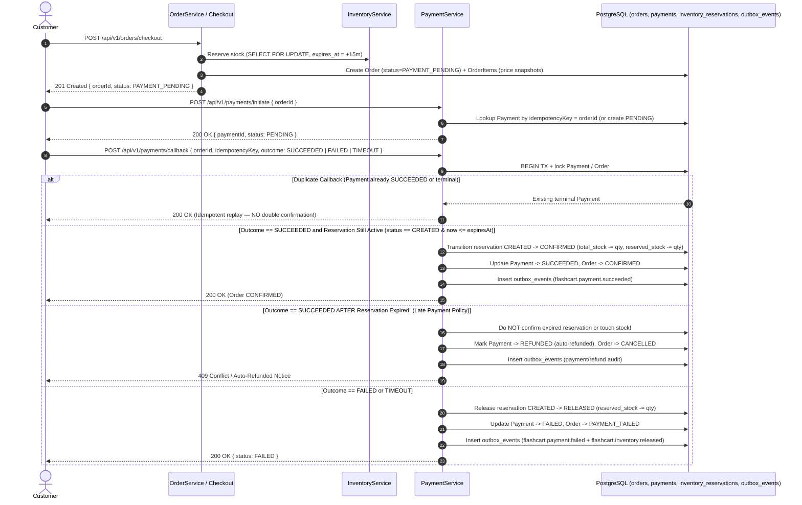

# FlashCart Payment Lifecycle & Idempotency Flow

FlashCart includes a deterministic **Payment Simulator** (`PaymentProvider.SIMULATOR`) engineered with the exact idempotency, state-transition, late-callback, timeout, and refund invariants required by real payment gateways like Stripe and Razorpay.

---

## 1. End-to-End Payment Sequence



---

## 2. Payment States & Transitions

### `PaymentStatus` Enum
- `PENDING`: Payment initiated, awaiting gateway callback or simulator action.
- `SUCCEEDED`: Payment authorized/captured and order confirmed.
- `FAILED`: Payment declined or timed out.
- `REFUNDED`: Payment reversed via explicit admin/user refund OR automatic late-payment refund after reservation expiry.
- `CANCELLED`: Payment voided prior to completion.

### `OrderStatus` Interaction
```
Order Created (PAYMENT_PENDING)
   ├── Payment SUCCEEDED (reservation active) ──> CONFIRMED ──> PROCESSING ──> SHIPPED ──> DELIVERED
   ├── Payment SUCCEEDED (reservation expired) ─> CANCELLED (+ Payment REFUNDED)
   ├── Payment FAILED / TIMEOUT ────────────────> PAYMENT_FAILED (+ inventory RELEASED)
   └── Confirmed Order Refunded ────────────────> REFUNDED
```

---

## 3. Idempotency Design & Duplicate Callback Handling

Real payment gateways (Stripe, Razorpay, Adyen) deliver webhooks with **at-least-once** semantics and retry on HTTP timeouts.
- **Database Constraint**: `payments.idempotency_key VARCHAR(255) UNIQUE NOT NULL`.
- **Key Format**: Uses `orderId` (or deterministic `order:<orderId>` / caller-provided idempotency key per payment attempt).
- **Duplicate Callback Protection**:
  - When `PaymentService` processes a callback, it locks the `Payment` / `Order` row within `@Transactional`.
  - If `payment.getStatus()` is already `SUCCEEDED` (or already processed with the same terminal outcome), the service returns the existing payment DTO immediately **without** calling `InventoryService.confirmReservation()` again and **without** emitting duplicate confirmation events.
  - Even if two identical webhook threads arrive simultaneously, the `UNIQUE` index on `idempotency_key` and row locking prevent double-confirmation or double stock deduction.

---

## 4. Late Payment Success After Reservation Expiry Policy

A critical distributed systems edge case occurs when:
1. A buyer creates an order (`PAYMENT_PENDING`) at `12:00`, reserving 1 unit until `12:15`.
2. The buyer leaves the payment page open; at `12:16`, the expiry scheduler transitions the reservation to `EXPIRED` and returns the 1 unit to available stock.
3. Another buyer immediately purchases that last unit at `12:17`.
4. At `12:18`, Buyer #1 finishes 3DS/UPI authentication and the gateway posts a `SUCCEEDED` callback!

**FlashCart's Policy**:
- **Never confirm an expired reservation.** Confirming it would steal stock already allocated to Buyer #2 or violate `reserved_stock <= total_stock`.
- `InventoryReservationRepository.transitionFromCreated(...)` enforces `WHERE id = :id AND status = 'CREATED'`. When `0` rows match (because `status == EXPIRED` or `now > expiresAt`), `PaymentService` catches the stale reservation, **auto-refunds** the payment (`PaymentStatus.REFUNDED`, `failureReason = "Reservation expired; auto-refunded"`), and cancels the order (`OrderStatus.CANCELLED`).

---

## 5. Payment Failure & Refund Simulation

- **Failure / Timeout Simulation**:
  - Simulator allows triggering `FAILED` (e.g., `"Insufficient funds"` or `"Card declined"`) or `TIMEOUT` (`"Gateway request timed out"`).
  - Both transition `Payment` → `FAILED`, transition `Order` → `PAYMENT_FAILED`, release active `CREATED` inventory reservations (`reserved_stock -= qty`, plus `flash_sale_items.sold_count -= qty` if flash sale), and emit `flashcart.payment.failed` + `flashcart.inventory.released` outbox events.
- **Refund Simulation**:
  - An authorized refund on a `SUCCEEDED` payment transitions `Payment` → `REFUNDED` and `Order` → `REFUNDED` (preventing double-refunds if called twice).

---

## 6. Integrating Stripe or Razorpay Later

Replacing `PaymentProvider.SIMULATOR` with Stripe or Razorpay requires minimal architectural change because the webhook and idempotency lifecycle is identical:
1. Add a `PaymentGatewayClient` interface with `StripeGatewayClient` / `RazorpayGatewayClient` implementations (`createPaymentIntent` / `createOrder`, `refundPayment`).
2. Add a webhook controller endpoint (e.g., `POST /api/v1/webhooks/stripe`) that **verifies the HMAC webhook signature header** (`Stripe-Signature` or `X-Razorpay-Signature`) using raw request bytes.
3. Map the verified webhook payload (`payment_intent.succeeded` / `payment_intent.payment_failed`) into the existing idempotent `PaymentService.handleCallback(...)` method.

---

## 7. Security Considerations

- **No Client-Submitted Amounts**: `PaymentService` reads `order.getTotalAmount()` directly from PostgreSQL—never from the payment initiation request body.
- **IDOR Prevention**: Customer endpoints verify `order.getUser().getId().equals(authenticatedUser.getId())`.
- **Callback Hardening**: In production with real gateways, simulator endpoints (`/simulate`) must be disabled or restricted (`@Profile({"dev", "test"})`), and webhook endpoints must verify cryptographic HMAC signatures before parsing payloads.
